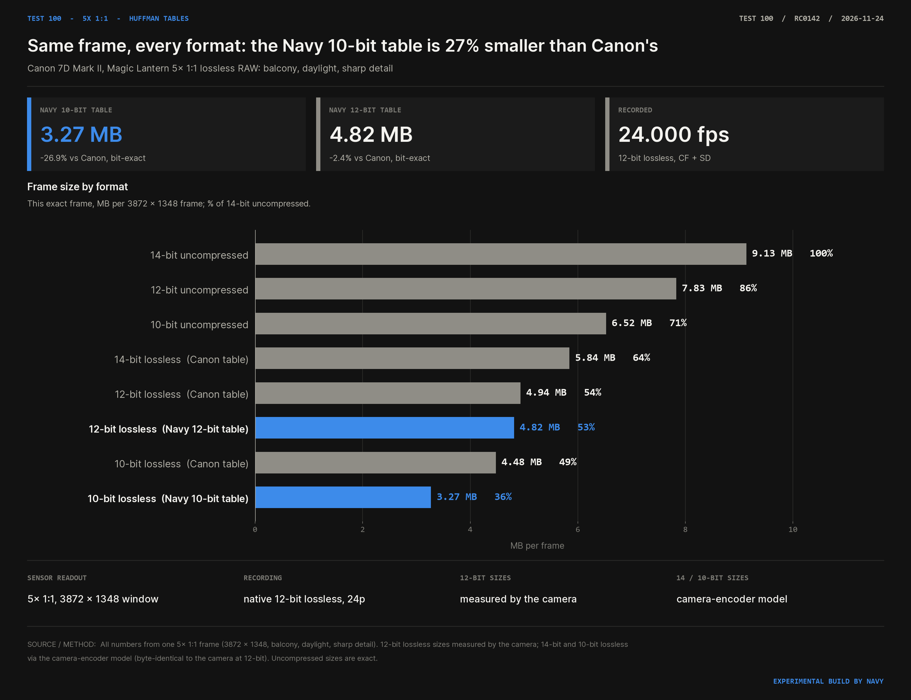
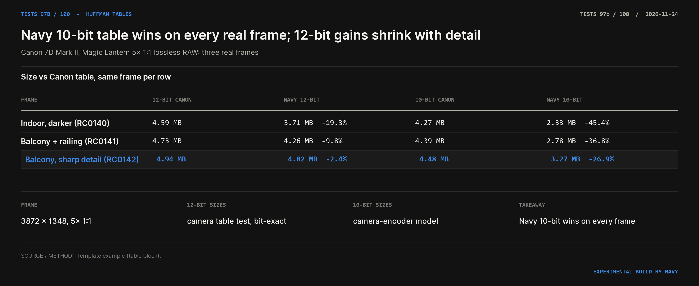

# Navy Huffman tables for lossless RAW on the Canon 7D Mark II

Tuned lossless-JPEG (LJ92) Huffman tables for **native 10-bit and 12-bit** lossless RAW video on the Canon EOS 7D Mark II
(firmware 1.1.2, DIGIC 6) with Magic Lantern. **Experimental work by Navy.**

Canon's encoder uses one Huffman table, built for 14-bit data, at every bit depth. At 10 and 12 bits the pixel differences
are much smaller, so that table wastes bits. The Navy tables are built for those depths. They only change how the
difference categories are coded. Every pixel decodes bit-exact, and each frame carries its own table (DHT), so standard
LJ92 decoders (e.g. MLV App) read the files unchanged.

## The tables

| Table | BITS (code lengths 1..16) | HUFFVAL | Bank CRC32 |
|---|---|---|---|
| Canon stock | `0 1 4 2 3 1 1 1 1 1 0 0 0 0 0 0` | `6 4 8 5 7 3 9 0 10 2 1 12 11 13 14` | `13E2A277` |
| **Navy 10-bit** | `0 3 1 1 1 1 1 1 1 1 1 0 3 0 0 0` | `0 1 2 3 4 5 6 7 8 9 10 13 11 12 14` | `2FC5550C` |
| **Navy 12-bit** | `0 2 3 1 1 1 1 1 1 1 1 1 1 0 0 0` | `0 3 1 2 4 5 6 7 8 9 10 11 12 13 14` | `32BDDFA8` |

Full definitions, including the encoder bank words (12 little-endian 32-bit words per component bank, written at JpCore
`0xD0100400` / `0xD0100440`), are in [tables/](tables/). Check them with `python tools/navy_tables.py tables/navy-10bit.json`.

## Results (camera-tested, bit-exact)

Same frame encoded with Canon's table and with the Navy table, 3872 x 1348, 5x 1:1 crop:

| Frame | Navy 12-bit vs Canon | Navy 10-bit vs Canon |
|---|---|---|
| Indoor, darker | -19.3 % | -45.4 % (camera test on a similar frame: -47.5 %) |
| Balcony, railing in front | -9.8 % | -36.8 % |
| Balcony, sharp detail everywhere | -2.4 % | -26.9 % |

All numbers are in [results/results.csv](results/results.csv). The 12-bit sizes and the first 10-bit result were measured by
the camera. The other 10-bit sizes come from a PC model of the camera's encoder, which matched the camera byte-for-byte
on every 12-bit frame. Brighter and more detailed frames carry more noise, so the saving shrinks with any table. At
12-bit, Canon's table is already close for busy daylight scenes. At 10-bit, the Navy table saves a quarter to a half.

## How it is applied on the camera

The recorder writes the Navy words into both encoder banks at each encode start of a native 10/12-bit take. It writes
Canon's words back at the end of the take and reads them back to prove the restore. 14-bit keeps Canon's table.

## Contents

- `tables/`: the three tables (JSON).
- `tools/navy_tables.py`: rebuilds the bank words and the DHT, and checks the CRC and Kraft sum.
- `results/`: the CSV, and an interactive entropy chart for the 10-bit frame.
- `sheets/`: result sheets.
- `template/`: the sheet generator (`navy_sheet.py`) and two example specs.

## Credits

- **Navy**: project lead, camera testing, the Navy tables.
- **Codex (OpenAI)**: firmware / ROM research (encoder banks, table locations) and design reviews.
- **Claude (Anthropic)**: camera test builds, table analysis, result sheets.

## Thanks

Feedback from the Magic Lantern Discord (names_are_hard, WalterSchulz, thebilalfakhouri) shaped the tests.

## License

GPL-2.0, to match Magic Lantern (see [LICENSE](LICENSE)).
